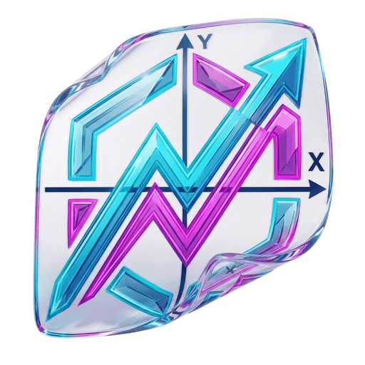

<p align="center">
  
</p>

<h1 align="center">Numeric Methods <sup>v3</sup></h1>

Numeric Methods — a Next.js application for the interactive study of numerical methods. A single repository targeting three platforms: **website** (`sonli-usullar.uz`), **Tauri v2 desktop**, and **Tauri v2 Android APK/AAB**.

## Development

```bash
bun install
bun dev
```

The website runs at `http://localhost:3000`.

## Website build & start

```bash
bun build
bun start
```

`next.config.ts` uses `output: "export"`. The build output is written to the `out/` directory. This static artifact is shared between website hosting and the Tauri frontend. Server actions, API routes, and server runtime features must not be used with this target.

## Netlify hosting

`netlify.toml` configures Netlify to run `bun run build` and publish only the generated `out/` directory. Deploy through the connected repository so the build runs before publishing. Do not upload the repository root as a static site: it contains source files rather than the generated homepage and produces a “Not Found” response at `/`.

## Vercel hosting

`vercel.json` explicitly selects Next.js, installs dependencies with Bun, and runs `bun run build`. The output directory uses the framework default so Vercel can handle `output: "export"` without a custom output-directory override. The shared static export for Tauri remains unchanged.

Set the Vercel project's Root Directory to the repository root, not `v2` or `v2/app`, so it reads this configuration and the current Next.js application. Redeploy the branch containing `vercel.json` after these changes. If `404 NOT_FOUND` persists, check that deployment's build logs and domain assignment; adding configuration alone does not prove the cause of an existing 404.

## Tauri desktop

After installing the Rust toolchain and platform-specific Tauri dependencies:

```bash
bun td
bun tb
```

The Tauri configuration is located in `src-tauri/tauri.conf.json`. `tauri:dev` or `td` runs the Next.js dev server, while `tauri:build` or `tb` first creates the `out/` static export and then builds the desktop bundle.

## Android APK

Soon
## Architecture

`app/` stores Next.js routes, `components/` holds the UI, `lib/` contains business logic, `public/` houses shared static assets, and `src-tauri/` stores the Rust shell and configuration. Web, desktop, and mobile versions share the same React UI; platform-specific features are added later as adapters via Tauri plugins.
